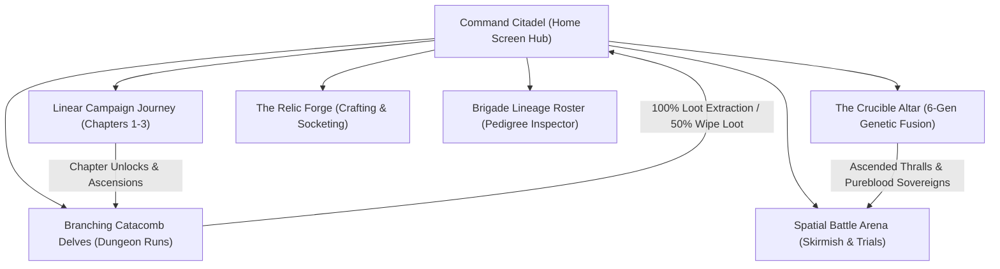

# MASTER GAME DESIGN DOCUMENT v3.3
## Unified Tactical Architecture, Overworld Progression & Catacomb Delve Systems
**Crucible of Ash: Dark Fantasy Roguelike Auto-Battler**
*Document Version: 3.3.0 | Date: October 2026 | Supersedes: MASTER_GDD_v3.2_SPATIAL_COMBAT.md & MASTER_GDD_v2.9.md*

---

## 1. Executive Summary & Design Vision

*Crucible of Ash* is a tactical dark fantasy miniature battler for mobile and desktop platforms. Built with a deterministic 30 Hz simulation engine decoupled from presentation, the game combines deep spatial unit placement, genetic breeding evolution, high-stakes dungeon extraction, and alchemical commander intervention.

### Core Architectural Pillars
1. **Physical Tabletop Presence:** Units are rendered as upright dark fantasy miniatures grounded on angled isometric contact plinths (embossed with runic borders and contact shadows).
2. **True Spatial Tactics (The 5x7 Node Arena):**
   * 5 columns $\times$ 3 rows of Allied Depth (Frontline Vanguard, Midline Skirmisher, Backline Arcanum).
   * 1 Central Dynamic Clash Line.
   * 5 columns $\times$ 3 rows of Hostile Territory with multi-tile Behemoth Boss footprints (e.g., Gorgoroth taking a 2x2 Colossus footprint).
3. **Adaptive Posture System (No Dead Turns):** Displacements, pulls, and knockbacks dynamically alter a unit's attack style rather than freezing or passing turns.
4. **Structural Bifurcation: Linear Campaign vs. Branching Roguelite Delves:**
   * **Linear Campaign Journey:** Story-driven sequential stages (Chapters 1–3, Stages 1–10) with horizontal progression, clear milestones, and ascension scaling (A0–A10).
   * **Branching Dungeon & Catacomb Delves:** High-stakes risk-and-reward node exploration with persistent HP carryover, safe **Runic Teleport Stone Extractions (100% Loot)**, and **50% Loot Salvage Penalties** upon party wipe.
5. **The Command Citadel War Room (Home Hub):** Centralized gothic command deck integrating commander vitals, live currency vaults, tactical mode launchers, and network/telco configuration.

---

## 2. Global Game Loops & Modes

### 2.1 The Two Expedition Modalities

| Feature | Linear Campaign Journey | Branching Dungeon & Catacomb Delve |
| :--- | :--- | :--- |
| **Path Structure** | **Linear Sequential Ladder** (Stages 1-1 to 1-10) | **Branching DAG Grid** (Depths 0 to 5) |
| **Pacing & Framing** | Horizontal overworld progression; no dead branches | Multi-path decision tree (Skirmishes, Altars, Crypts, Elites) |
| **Squad Health** | Fully revives between campaign stages | **Persistent HP**: Wounds carry over across rooms |
| **Exit Condition** | Clear stage to unlock subsequent stage | **1. Runic Teleport Stone:** Safe exit with 100% loot. **2. Boss Slay:** Complete run + Pureblood drop. **3. Team Wipe:** 50% salvage penalty. |
| **Difficulty Scaling** | Ascension Tiers A0 to A10 (HP/ATK/SPD multipliers) | Environmental Hazards & Tier Torment modifiers |

---

## 3. Dungeon Delve Risk/Reward & Runic Extraction

### 3.1 The Delve Loot Sack
During a Catacomb or Dungeon expedition, currencies are diverted into a temporary **Delve Loot Sack**:
* **Raw Ichor:** Fuel for genetic evolution and fusion.
* **Cursed Ore:** Material for relic reforging and socketing.
* **Bloodline Sigils:** Rare tokens for pureblood consecration.

### 3.2 The Decision Threshold: Runic Teleport Stone
Deep within the delve (Depth 3/4), players discover an ancient **Runic Teleport Circle**:
1. **Safe Extraction (100% Haul):**
   * Transports the brigade directly back to the Command Citadel.
   * Transfers 100% of the Delve Loot Sack into permanent account reserves.
   * Squad is fully restored to maximum health.
2. **Press Deeper (High-Risk Titan Chamber):**
   * The portal collapses; the brigade advances directly into the Dungeon Boss or Elite Chamber.
   * Guaranteed bonus rewards on victory: **Generation 4 Pureblood Thrall Drop** + **Legendary Relic Drop**.

### 3.3 The 50% Defeat Salvage Penalty
If all 5 members of the brigade are incapacitated inside a delve:
$$\text{Ichor Salvaged} = \max\left(25, \left\lfloor \text{DelveIchor} \times 0.50 \right\rfloor\right)$$
$$\text{Ore Salvaged} = \left\lfloor \text{DelveOre} \times 0.50 \right\rfloor$$
* The remaining 50% of the gathered run loot is lost to the dungeon shadows.
* Squad returns to the Citadel with wounds bound (revived to 100% HP).

---

## 4. The 2.5D Isometric Spatial Node Battlefield

### 4.1 The Coordinate Matrix & Depth Layering
* **Columns:** $0 \dots 4$ (Col 1 to Col 5).
* **Global Rows ($gRow$):** $0 \dots 6$
  * $gRow \in [0, 2]$: Hostile Territory ($gRow = 2$: Front, $gRow = 1$: Mid, $gRow = 0$: Back).
  * $gRow = 3$: Central Clash Line.
  * $gRow \in [4, 6]$: Allied Regiment ($gRow = 4$: Vanguard Front, $gRow = 5$: Skirmisher Mid, $gRow = 6$: Arcanum Back).

$$\text{Contact Depth (Z-Index)} = gRow \times 10 + \text{column}$$

* **Stack Ordering:**
  1. Floor Terrain Canvas (35 diamond tiles, grid borders, drop-target zones).
  2. Miniature Plinth Layer (units and multi-tile colossi sorted ascending by Contact Depth).
  3. Tactical Intent Layer (trajectory arrows, telegraph countdown arcs, AOE splash rings).
  4. Kinetic Particle FX (slash trails, piercing beams, ground shockwaves).

### 4.2 The Unit Combat Triad
Each miniature operates under a 3-part combat architecture:
1. **Automated Basic Action:** Executes upon reaching 10,000 Action Points ($\Delta\text{AP} = \text{Speed} \times 1.25$ per tick).
2. **Stance Mastery (Passive Plinth Aura):** Positional requirements grant active combat boons:
   * *Vanguard (Frontline, $gRow = 4$):* +30% Armor (PRR), Stagger Immunity, Lateral Cleave Bash.
   * *Skirmisher (Midline, $gRow = 5$):* +40% Crit against bleeding foes, 3,000 AP refund on displacement.
   * *Arcanum (Backline, $gRow = 6$):* Full column penetration, Guarded status (-20% ranged damage taken).
   * *Support (Adjacent Allies):* 3% Max HP/sec aura and automatic debuff dispels.
3. **Manual Ultimate Burst:** High-impact commander cards cast during a **30% tactical bullet-time slowdown**.

### 4.3 Adaptive Posture System
When displaced by knockbacks, pulls, or tactical nudges, units adapt their combat stance rather than skipping turns:
* *Vanguard in Backline:* Cannot strike melee; executes **Braced Bulwark**, projecting +25 Armor to allies ahead and charging Ultimate gauge by 20%.
* *Arcanum in Frontline:* Loses Guarded status; basic spell triggers a radial **Panic Discharge** knocking adjacent hostiles back 1 tile.

---

## 5. Genetic Crucible & 6-Generation Pedigree

### 5.1 Deterministic Fusion Math ($32\times\text{ G1} = 1\times\text{ G6}$)
* **G1 (Thrall):** Level cap 20; 1 Basic Skill; 0 Plinth Sockets.
* **G2 (Hardened):** Level cap 30; Signature Skill unlocked.
* **G3 (Veteran):** Level cap 40; Unlocks Plinth Trait Socket 1.
* **G4 (Dread):** Level cap 50; Ultimate Burst unlocked.
* **G5 (Ascended):** Level cap 60; Unlocks Plinth Trait Socket 2; Apex Visual Form.
* **G6 (Pureblood Sovereign):** Level cap 70; Unlocks Plinth Trait Socket 3; +15% Pureblood Resonance across all base stats.

### 5.2 Pedigree Trait Grafting & Heritage Sheets
* Progenitor A + Progenitor B transmit:
  * 1 Native Trait from Parent A.
  * 1 Selectable Graft Trait chosen from Parent B.
  * 1 Mutation Chance roll during ritual ignition.
* **Interactive Faction Pedigree Inspector:** Two-sided tactical character card rendering live front vitals (HP, ATK, DEF, SPD stat chips) and back ability arsenal with slotted runic equipment.

---

## 6. Commanders & Asymmetric Grimoires

Commanders occupy a physical miniature plinth on the battlefield while channeling Focus to execute Grimoire Orders:

| Commander | Faction | Starting / Max Focus | Signature Aura | Keystone Order |
| :--- | :--- | :---: | :--- | :--- |
| **Lord Vladislav** | Ash Legion | 1 / 4 | **Crimson Tithe:** +8% Lifesteal against Bleeding targets | **Feast of Ruin (3 Focus):** Execute enemy below 20% HP; surge squad with +50% Turn Meter |
| **Lady Valeria** | Calx Order | 1 / 3 | **Iron Aegis:** Frontline Vanguard gains +25% Armor & reflects 15% DMG | **Smite the Wicked (3 Focus):** Divine strike scaling with 80% total squad Armor |
| **Malakor** | Mire Coven | 1 / 3 | **Carrion Miasma:** Ally death inflicts 2 Blight stacks to all hostiles | **Rebind Flesh (3 Focus):** Resurrect fallen ally with 40% HP & 100% TM |
| **Morrigan** | Crypt Stalkers | 1 / 3 | **Temporal Threads:** +10% Speed; crits grant +5% Turn Meter | **Echoing Hourglass (3 Focus):** All allies gain +40% TM & -1 skill cooldowns |

---

## 7. Command Citadel, Audio & Telco Settings

The Command Citadel provides players with complete control over presentation and connectivity:

### 7.1 Telco & Network Adaptation
* **Carrier Profiles:**
  * *Auto (Adaptive 4G/5G):* Dynamic bandwidth allocation.
  * *High Bandwidth (Wi-Fi / 5G Ultra):* High-res textures and uncompressed audio conduits.
  * *Telco Data Saver (Metered 3G/4G):* Compresses asset transfers, reduces background sync, and suspends high-res telemetry over metered cell towers.
  * *Airgap Offline Mode:* Full local execution powered by local IndexedDB/SharedPreferences caching.
* **Offline Local Storage Cache:** Caches campaign progression, squad rosters, and fusion pedigrees directly on device.

### 7.2 Tactical & Audio Presentation
* **Audio Channels:** Independent volume sliders and toggles for Background Music and Sound FX.
* **Presentation Controls:** Screen impact shake, floating combat text (Armor absorption, True DMG, Stagger), high-contrast plinth HP bars, and spell spark particle conduits.
* **Auto-Bullet Time:** Automatically slows simulation to 30% when an enemy boss primes a telegraphed AoE channel.

---

## 8. Environmental Hazards & Ascension Scaling

### 8.1 Environmental Overworld Hazards
* **Ashen Emberstorm (Chapter 1):** Scorching winds deal 2% Max HP burn damage to non-Vanguard units per turn.
* **Necrotic Miasma (Chapter 2):** Blighted vapors reduce all combat healing & shield generation by 25%.
* **Abyssal Void Flux (Chapter 3):** Gravity flux causes turn meters & AP accumulation to fluctuate $\pm 15\%$.

### 8.2 Ascension Tiers (A0 to A10)
Ascension tiers introduce stacking multipliers to test endgame squad compositions:
$$\text{Enemy HP} = \text{BaseHP} \times (1 + 0.12 \times \text{Tier})$$
$$\text{Enemy DMG} = \text{BaseATK} \times (1 + 0.08 \times \text{Tier})$$
$$\text{Enemy SPD} = \text{BaseSPD} \times (1 + 0.03 \times \text{Tier})$$

---

*Crucible of Ash — The Living Mineral Tactical Miniature Wargame.*
