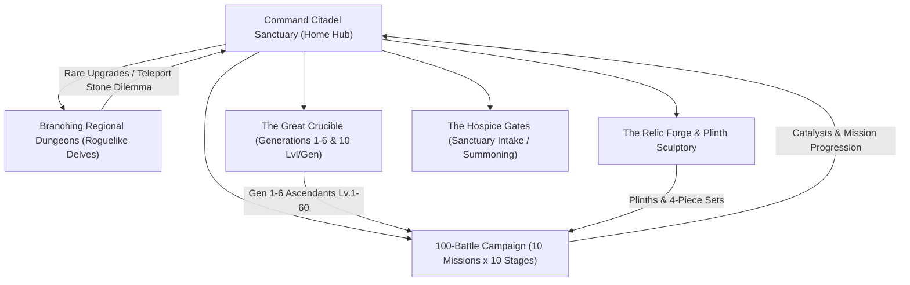

# MASTER GAME DESIGN DOCUMENT v3.4
## The Itinerant Alchemist, Citadel Sanctuary, 100-Battle Campaign & 10-Level Lineage Architecture
**Crucible of Ash: Dark Fantasy Roguelike Auto-Battler**
*Document Version: 3.4.0 | Date: October 2026 | Supersedes: MASTER_GDD_v3.3.md*

---

## 1. Executive Summary & Narrative World Vision

*Crucible of Ash* is a dark fantasy tactical miniature battler for mobile and desktop platforms. Set in a dying world undergoing petrification—the *White Ash Cataclysm*—where humanity calcifies into brittle stone, you are not a prophesied god or chosen conqueror. 

You began as an **itinerant alchemical physician**: a lone wanderer with a single mule and a battered mobile workbench, treating dying refugees on the road by halting calcification with volatile catalysts (quicksilver, vitae, solar-iron) and discovering that transmuted ash yields superhuman resilience.

As word spread across the wastes, dying warriors, rogue commanders, and infected deserters followed your trail. To sustain them, you founded **The Ashen Citadel Sanctuary**—a fortified alchemical haven built atop an ancient Vitae spring where the petrification naturally slows. Your settlement has grown into an independent city-state sought after by noble factions and targeted by apocalyptic cults.

---

## 2. Global Game Loops: The Four Pillars

---

## 3. The 10-Level Per Generation System ($G1 \rightarrow G6$)

Every unit's cellular evolution and potential is governed by their **Generation ($G1 \rightarrow G6$)**. The maximum level cap is strictly $10 \times \text{Generation}$:

$$\text{MaxLevel}(\text{Gen}) = \text{Generation} \times 10$$

| Generation | Roman Badge | Title / Cellular Purity | Level Range / Cap | Mechanical Milestones & Unlocks |
| :---: | :---: | :--- | :---: | :--- |
| **Gen 1** | **I** | **Stabilized Thrall** | **Lv. 1 – 10** | Emergency triage patient; basic attack, native trait. |
| **Gen 2** | **II** | **Infused Veteran** | **Lv. 1 – 20** | +15% Base Stat Multiplier; 1st Crucible Grafted Trait active. |
| **Gen 3** | **III** | **Alchemical Vanguard**| **Lv. 1 – 30** | **Signature Skill Unlocked** (auto-procs every 3 turns); 2-piece Relic synergy. |
| **Gen 4** | **IV** | **Pureblood Paragon** | **Lv. 1 – 40** | +15% Pureblood Bonus; 2nd Grafted Trait; Plinth Pedestal Mastery (+15% plinth passives). |
| **Gen 5** | **V** | **Ascendant Champion** | **Lv. 1 – 50** | +25% Ascendant Multiplier; Ultimate Meter charges 25% faster; 4-piece Relic synergy. |
| **Gen 6** | **VI** | **Apex Sovereign** | **Lv. 1 – 60** | **Apex Purity**: 100% stat transfer, dual trait trigger, golden lineage aura. |

### 3.1 Rarity Consecration vs. Generational Evolution
* **Generation ($G1 \rightarrow G6$):** Raised by fusing two matching-species units at max level in the Crucible. Dictates the unit's **Level Cap** (Lv. 10 $\rightarrow$ 60) and trait slots.
* **Rarity (Common $\rightarrow$ Legendary):** Raised by spending Ichor on max-level units or performing **Duplicate Ascension** in the Crucible. Grants $+15\%$ HP, ATK, and DEF per rarity tier.
* **Level Progression:** Increases raw stats incrementally via combat XP or Ichor infusion ($100 \times \text{Level}$ XP per level).

---

## 4. The 100-Battle Campaign (10 Regional Missions $\times$ 10 Stages)

The linear campaign comprises **10 complete Regional Missions**, each containing **10 sequential battle stages** (Stages 1 through 10), culminating in 100 hand-crafted tactical encounters across 3 Acts:

### ACT I: THE FRONTIER OUTPOST (Missions 1–3, Stages 1–30 • Lv. 1–20)
* **Mission 1: The Outskirt Wreckage (Stages 1-1 to 1-10):**
  * *Narrative:* Push back feral ash-ghouls from your perimeter; triage and rescue your First Commander (Lord Vladislav).
  * *Boss (1-10):* Feral Alpha Behemoth (Unlocks baseline G1 recruits and triage clinic).
* **Mission 2: The Smoldering Barricade (Stages 2-1 to 2-10):**
  * *Narrative:* Clear entrenched scavengers from an abandoned Ash Legion checkpoint.
  * *Boss (2-10):* Slag-Carapace Sentinel (Secures cold-rolled tools; unlocks Tier 1 Crucible).
* **Mission 3: The First Beacon Pulse (Stages 3-1 to 3-10):**
  * *Narrative:* Ignite the town's makeshift Resonance Beacon against an ash-storm assault.
  * *Boss (3-10):* Hearth Ash-Colossus (Secures town perimeter; unlocks permanent Sanctuary Gates).

### ACT II: THE REGIONAL EXPEDITIONS (Missions 4–7, Stages 31–70 • Lv. 20–40)
* **Mission 4: Forge-Master's Gate (Stages 4-1 to 4-10):**
  * *Region:* Basalt Ridges (Ash Legion territory).
  * *Boss (4-10):* Dreadnought Colossus (Harvests Solar-Iron; unlocks Tier 2 Relic Forge & Iron Plinths).
* **Mission 5: The Molten Caldera (Stages 5-1 to 5-10):**
  * *Region:* Central Volcanic Caldera.
  * *Boss (5-10):* Gorgoroth the Flayed (Claims the Master Crucible Core; unlocks **Gen 3** fusion and level cap 30).
* **Mission 6: The Glass Scriptorium (Stages 6-1 to 6-10):**
  * *Region:* Quicksilver Veins (Calx Order territory).
  * *Boss (6-10):* Arch-Lich Malakor (Secures Quicksilver Spring; expands Grimoire deck to 6 active cards).
* **Mission 7: The Petrified Bog-Lands (Stages 7-1 to 7-10):**
  * *Region:* Mire Coven Weeping Canopy.
  * *Boss (7-10):* Mother Morrigan's Avatar (Harvests biological hardening agent; unlocks **Gen 4 & 5** and level cap 50).

### ACT III: THE CRUCIBLE WAR & PRIME ORIGIN (Missions 8–10, Stages 71–100 • Lv. 40–60)
* **Mission 8: The Obsidian Sepulcher (Stages 8-1 to 8-10):**
  * *Region:* Deep Crypt Catacombs.
  * *Boss (8-10):* Strigoi Blood-Lord (Harvests Deep Vitae; unlocks Gold & Obsidian Plinths).
* **Mission 9: The Tectonic Trench (Stages 9-1 to 9-10):**
  * *Region:* Subterranean Fissures.
  * *Boss (9-10):* Tectonic Engine Juggernaut (Claims the Prime Crucible Igniter; unlocks **Gen 6 Apex Sovereigns** and level cap 60).
* **Mission 10: Siege of the Ash-Spire (Stages 10-1 to 10-10):**
  * *Region:* The Central World-Wound.
  * *Boss (10-10):* The Grand Inquisitor & Primordial World Titan (The final apocalyptic showdown).

### 4.1 Campaign Difficulty Multipliers
* **Normal Mode (100 Battles):** Units Lv. 1–30. Teaches mechanics, unlocks town blueprints.
* **Hard / Torment (100 Battles • H1-1 to H10-10):** Units Lv. 30–50. Enemies gain +50% stats, hazard affixes; drops double Ichor, Cursed Ore, and 4-piece sets.
* **Nightmare / Ascension (100 Battles • N1-1 to N10-10):** Units Lv. 50–60 (Gen 6 Apex required). Ruthless AI, speed enrage timers; farms Bloodline Sigils.

---

## 5. "Choose-Your-Own-Adventure" Regional Dungeons (Catacomb Delves)

While the Campaign is linear, **Dungeons (The Catacomb Delves)** are branching roguelike expeditions focused on farming rare catalysts:
* **Persistent HP:** Damage carries across battle nodes.
* **Interactive Node Choices:**
  * **Skirmish & Elite Nodes:** Farm Cursed Ore and combat boons.
  * **Rest Havens:** Bind wounds (+30% HP) or buff armor (+15 Aegis).
  * **Ancient Altars:** Blood covenants (trade Max HP for permanent run attack).
  * **Crypt Sarcophagi:** Risk-reward alchemical loot or traps.
* **The Runic Teleport Stone Dilemma:**
  * Placed immediately before the Boss Chamber.
  * **Safe Extraction:** Leave immediately with **100%** of accumulated haul.
  * **Press to Boss Vault:** Defeat the Boss to unlock the **Max Loot Tier** (rare facility catalyst); wiping causes a **50% loot loss**.

---

## 6. Town Facility Gating & Citadel Districts

Your Sanctuary is divided into **Four Core Districts**, upgraded via catalysts secured from Campaign and Dungeon bosses:

1. **The Hospice Gates (Summoning & Triage):**
   * *Tier 1 (Act I):* G1 Thralls, 15 Roster capacity.
   * *Tier 2 (Act II):* Faction-specific banners, 25 Roster capacity.
   * *Tier 3 (Act II):* Elite Bloodline banners, 40 Roster capacity.
   * *Tier 4 (Act III):* Legendary Pilgrims & Commander duplicates.
2. **The Great Crucible of Blood (Fusion & Evolution):**
   * *Tier 1:* Gen 1 only (Max Level 10).
   * *Tier 2:* Unlocks Gen 2 & 3 (Max Level 20 & 30); unlocks Trait Grafting.
   * *Tier 3:* Unlocks Gen 4 & 5 (Max Level 40 & 50); Duplicate Ascension.
   * *Tier 4:* Unlocks Gen 6 Apex Sovereigns (Max Level 60); 100% stat transfer.
3. **The Relic Forge & Plinth Sculptory:**
   * *Tier 1:* Common 2-piece sets, Stone Plinths.
   * *Tier 2:* 4-piece sets, Cold Iron Plinths (+15% Armor), Crypt Bone Plinths (+25% Vampiric Siphon).
   * *Tier 3:* Obsidian Plinths (+10% ATK), Gold Plinths (+10% All Stats), relic reforging.
4. **The Leyline Reservoir & Archives:**
   * *Tier 1:* 4-card deck, 3 Max Focus.
   * *Tier 2 (Quicksilver Siphon):* 6-card deck, 5 Max Focus.
   * *Tier 3 (Resonance Spire):* 7 Max Focus, +1,500 battle-start AP.
